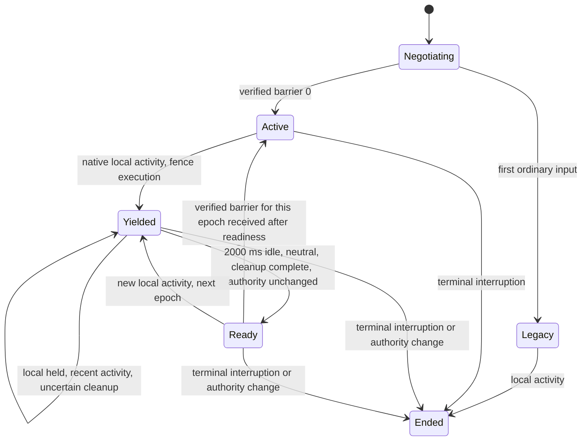
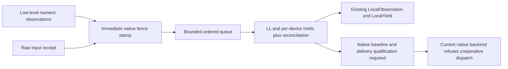

# Native cooperative input

Status: scheduler and executor integration **Implemented / Verified in simulation**.
The native Windows observation adapter and bounded hold model are **Implemented /
Experimental**, with fake-source verification only. Actual hook/raw-device behavior,
delivery arbitration, connected runtime and native UI remain **Planned / Not Verified**.
The packaged endpoint does not advertise `localYield`.
Existing local-activity termination and production feature switches remain unchanged.

## Canonical contract

The protocol sources originate at `e45cc8f20b3060e8231ecafc29c2417ee6f42040` and are unchanged in the read-only frozen revision `01ae58565dd29dce692bace6d09834c5efdbff69`.
Windows pins the exact control protocol, cooperative reference, extension validator,
yield fixture and interoperability manifest. All earlier v1/v2/Profile 2/release
fixtures remain unchanged. The manifest preserves the earlier 23 acceptance cases
and adds WIN-Y01 through WIN-Y04. The frozen manifest v3 has 30 total cases, also including native peer loss (WIN-L06), endpoint crash (WIN-L07) and active-session updates (WIN-U01).

Extension v3 and endpoint enrollment must declare `localYield` only after the actual
native path qualifies. Every peer must additionally opt in with `input-barrier`
epoch zero before its first ordinary input. A legacy peer keeps terminal local-input
behavior. The control protocol remains v2; the feature is separate from Profile 2.

## Scheduling and authority

`cooperative.rs` owns scheduling and bounded local-hold state. It does not own a
second helper input ledger, grant registry or executor. `SessionGate` remains the
signed authority. Its opaque semantic snapshot binds the gate instance, session,
input authority epoch, capture geometry/generation and input grants, generations,
local consent and lease coverage. Routine renewal of the same valid covering lease
does not change that snapshot. Independent resource bookkeeping is excluded.

Barriers pass current grant, device/session/peer, consent, generation, sequence,
lease and sender-age checks in `SessionGate`. They never become injectable Actions.
Their sender timestamp uses release-like age handling. A delayed post-readiness
barrier receives a fresh short dispatch window; its original native ingress time
still prevents a queued pre-readiness barrier from becoming valid later.

The scheduler checks semantic authority on every admission, including releases and
barriers, in addition to ticks. An authority change cannot be hidden between a
readiness event and the next timer. Epoch exhaustion, stale observation provenance
and terminal interruptions cannot reactivate the old scheduler.

An independent atomic `InputFence` invalidates expanded shortcut/text primitives
without revoking service grants. Native observation stamps its event before ordinary
queue processing. Processing one event cannot acknowledge a later unseen local hold.
Lost observation continuity stays uncertain; foreign or replayed observation handles
end admission. The dormant native observer now stamps at callback receipt, including
RAW-first activity before packet/device queries. Its production/runtime attachment
and actual device qualification remain unfinished.

## Windows observation implementation

`observation.rs` tracks low-level provisional holds, independent raw per-device
holds and bounded unresolved transition journals. Effective ownership is their
union. Neither LL-UP nor RAW-UP alone clears a hold; two keyboards holding the same
key require both raw releases. Repeat does not add another hold. Matching follows
ordered transitions, never timestamp proximity or a presumed raw/LL delivery order.
An unresolved transition expires to uncertainty, not neutrality.

`windows/physical_activity.rs` uses one message-only Raw Input target and a separate
monitor lifetime. It registers INPUTSINK/DEVNOTIFY without suppressing legacy input,
hotkeys or mouse capture. A shared slot prevents simultaneous legacy/cooperative
monitor instances in one native process. It refuses existing class registrations,
detects replacement and removes only targets bound to its own window. The legacy
terminal monitor remains the selected implementation in existing native execution.

Low-level callbacks copy numeric events into a preallocated 512-entry queue and
pause the existing InputFence before deferred work. They pass all input onward.
Mapping, raw-device queries, reconciliation and output delivery occur outside hook
callbacks. FenceStamp is not cloneable; converting it to LocalObservation does not
pause twice. Queue overflow, reentry, stale stamps, unknown provenance, unsupported
scans and device-generation loss fail closed. Observation remains live across an
ordinary yield. Stop/failure fences before native cleanup, and cleanup failure is
sticky. Independent resource permissions are not revoked by this observer.

Limits are 32 retained device records, 256 holds per device/LL set and 512 unresolved
transitions. Packet size/type/flags and device information are checked. Zero device
handles, including unsupported precision-touchpad ownership, are uncertainty;
coalesced opposite button transitions and unsupported E1 data are not guessed.
International observation reuses the existing scan mapping without adding remote
Windows/security keys. No text conversion, clipboard, file or consent API exists.
Bounded in-flight numeric correlation data is discarded as transitions reconcile;
it is never logged or retained as typing history.

The new observer never qualifies an initial baseline: an empty table, timer,
GetAsyncKeyState or application tag cannot establish per-device physical neutrality.
`Snapshot.require_neutral()` refuses the current unqualified baseline. A future
runtime must enforce this in addition to signed authority, native cleanup and the
existing barrier checks. The snapshot is descriptive and cannot authorize input.

**Delivery enforcement remains unresolved.** Windows can silently remove a low-level
hook after a timeout, without reliable notification. A thread heartbeat or earlier
canary acknowledgement cannot prove interception of the next synthetic UP. A missing
acknowledgement after SendInput is too late to prove that UP did not reach a local
host hold. Do not turn on `cooperative_ready` or advertise `localYield` using only
this observer, tags or hook liveness. This requires a reviewed delivery mechanism
and device acceptance, not another web protocol. See Microsoft's
[keyboard hook documentation](https://learn.microsoft.com/en-us/windows/win32/winmsg/lowlevelkeyboardproc)
and [Raw Input registration rules](https://learn.microsoft.com/en-us/windows/win32/api/winuser/nf-winuser-registerrawinputdevices).

[Implementation evidence and remaining gates](evidence/2026-11-10-physical-observation.md).

## Ownership and retained cleanup

`Executor::dispatch_cooperative` reuses existing permits, primitive expansion and
grant-scoped ledgers. It requires an explicitly qualified backend. The existing
Windows and subprocess adapters return false, so this path cannot accidentally
enable cooperative injection. Native-fence interruption is a handled nonterminal
drop; arbitrary backend or clock errors keep terminal failure behavior.

`yield_owned` first requires nonterminal backend quiescence. Each owned release must
receive a positive native disposition: released, or handed over to the host without
an injected UP. Only then are the existing local and per-grant ledgers updated.
Uncertain delivery and failed mirror synchronization keep cleanup pending. Terminal
cleanup and Drop retain the owner and retry the final mirror even after the local
ledger becomes empty. No helper DOWN is automatically reissued after a barrier.

These adapter obligations are not satisfied by a bitmap check or `SendInput`'s
insertion count. The delivery arbiter must protect ordinary input, executor cleanup
and the guardian's surviving mirror. A host DOWN racing a helper UP must never be
released by stale snapshot-based cleanup.

## Remaining native integration

COOP-2 found no documented conditional release operation for the shared
Windows desktop input stream. A valid observation before `SendInput` can
become stale before delivery. A hook can disappear before observing that
release, and a late acknowledgement cannot protect the host's already
affected hold. Cooperative input and `localYield` remain unavailable.

Normal dormant runtimes now register their executor Stop event with the
local safety window before worker startup. An input-only Stop and lease
loss signal the same event. The native custody registry retains unresolved
armed ownership until it has exact process exit and both terminal receipts.
The normal executor still needs its dedicated monitor-owned receipt channel.
[Delivery decision and test evidence](evidence/2026-11-10-coop2-delivery-and-stop.md).

1. Finish monitor-owned executor generation registration and positive terminal
   cleanup receipts before admitting active input. Job/process exit alone is not proof.
2. Implement independently owned physical observation and bounded delivery arbitration.
   Track scan/extended identities, buttons and uncertain provenance before the first
   remote DOWN. Preserve observation across ordinary yields. Never use synthetic
   cleanup events or renderer `isTrusted` as local consent.
3. Qualify known-neutral startup, actual versus injected events, foreign injection,
   low-level hook timeout/removal, multiple physical keyboards/mice, AltGr/IME and
   protected-desktop transitions. `GetAsyncKeyState` alone cannot establish ownership.
4. Connect the persistent native runtime, native Stop/consent, extension v3 display
   events and the peer's monotonic endpoint status sequence. Bind readiness to actual
   quiescence/mirror acknowledgements and verified current authority.
5. Run WIN-Y01 through WIN-Y04 on an approved disposable device. Until then keep
   `localYield` unadvertised and real-device acceptance Not Verified.

Clipboard, files and viewing remain independently authorized. Ordinary yield must
not call `suspend_input`, the terminal backend fence, or a service revocation path.
Stop, revocation, lock/protected desktop, sensitive native UI, lease/peer/source loss,
session replacement, expiry and stream end remain terminal and require fresh authority.

See [evidence](evidence/2026-11-08-cooperative-core.md),
[runtime plan](ASSIST-RELEASE-PLAN.md) and [device qualification](https://github.com/cortezdemartino/palisade-windows/issues/5).
