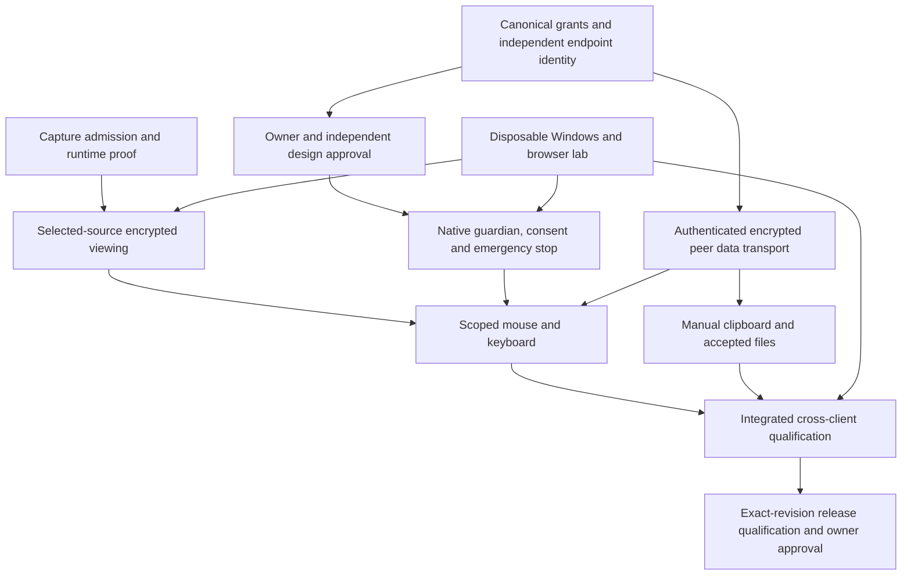

# Palisade Assist resolution plan

Historical plan. Current implementation and remaining gates are recorded in [ASSIST-INTEGRATION.md](ASSIST-INTEGRATION.md) and [M4G-WINDOWS-REPORT.md](M4G-WINDOWS-REPORT.md). Canonical stream/group v2 now exists at companion c0778935a6a08303bf7a9d7de8f2fa75aa8ef536. Owner architecture approval and independent reviews of dormant components are complete; activation and product acceptance are not.

Implementation plan, 2026-10-24. This document records engineering direction, not permission to implement privileged input, change the companion repository, install, activate or release. The first capture-admission follow-up is recorded below and in TEST-RESULTS.md; later stages remain planned or blocked.

Baseline: Windows `ed6f1628a927c5e08ee8d8b71be8dd4b4b4091dc`; web contract `6c7ab894862ca3767b1239594e37c322e96ff2c4`; Electron 44.7.2. The verified baseline has 65 passing tests and packaged component checks. It does not have working native capture, remote input, OS clipboard sharing or direct file transfer.

## Recommended route

Owner-approved amendment, 2026-10-25: [stream-bound group sessions](ASSIST-STREAM-SESSIONS.md) supersede the proposed future product's fixed pairwise/fifteen-minute model. Allow viewer requests and streamer invitations, host-selected permissions and up to two hours, with terminal revocation when the exact stream ends. Owner architecture approval is recorded in #33; independent review remains outstanding. Existing fifteen-minute code/contracts below describe legacy/current behavior and must not be silently relaxed before the new canonical version is integrated.

Resolve capture admission first while the companion protocol, endpoint identity review and disposable test lab are prepared in parallel. Qualify real encrypted viewing before adding input. Build independent local stop before enabling the first native input event. Add manual clipboard transfer and simple accepted files before automatic sync, drag-and-drop or resume.

The issues represent different kinds of work. Windows #3 is an engineering investigation plus security review; the owner does not need to diagnose Electron. Windows #4 requires companion implementation authorization because that repository is read-only here. Project-palisade#33 requires the owner/independent architecture decision before input execution. Windows #5 requires test resources and installation authorization. A green component build resolves none of those decisions automatically.

## 0. Freeze the baseline and acceptance rules

**Engineering outputs:** retain the passing baseline, map every advertised capability to its real implementation and grant, preserve v1's exact three-member/seven-field interface, and use one candidate ledger for both repository SHAs. Work on main in verified slices; use the existing output directory and no extra checkout/feature branch. Preserve updater trust, fuses, application identity and the persistent Matrix profile.

Classify every scenario before implementation. A Windows app host can eventually support Windows and browser guests. A pure browser host without an approved native host endpoint cannot receive OS keyboard/mouse control. Browser-to-browser remains view/collaboration only unless the host has such an endpoint. Browser clipboard/download restrictions remain in force. Do not promise a capability merely because both users see an Assist card.

**Exit:** a single matrix identifies viewing, input, each clipboard direction and each file direction, their actual provider, approval dependency and test owner. Native operation, installation and production activation remain separate decisions.

## 1. Resolve capture admission, not merely the permission error — Windows #3

### 1A. Close the current test gap and contain all legacy paths

**Executed follow-up:** the thirty-case Windows fixture covers fifteen request shapes with controller availability false/true on Electron 44.7.2 and the official 45.0.0 runtime. Mixed legacy/microphone requests were rejected by Chromium renderer termination before permission callbacks; no capture bypass was demonstrated. On 45.0.0, the old available-controller rule admitted four modern/legacy display requests in the fixture. The safety observer refused those grants before capture. Production session policy now denies display capture independently of controller availability, and main keeps capture reporting unavailable independently of the build flag. Both runtimes pass the matrix with that guard. No runtime dependency was changed and no positive capture result is claimed.

Retain a bounded runtime comparison using disposable fixture windows, synthetic accounts and no personal desktop content. Cover modern display requests, legacy desktop/screen/tab constraints, missing/guessed source IDs, subframes and mixed microphone plus legacy screen requests. The newly executed mixed combinations did not obtain a grant; additional combinations and positive selected-source enforcement still require qualification. Earlier empty-media denial tests alone did not establish that result.

The [Electron 45 source](https://github.com/electron/electron/blob/v45.0.0/shell/browser/web_contents_permission_helper.cc) classifies screen requests separately from device media, but retains distinct legacy and modern grant paths. Runtime comparison confirms that controller availability must not enable its generic display permission. Keep the existing runtime pin until a supported path enforces the actual selected source; a classification improvement alone does not supply that guarantee.

**Deliverable:** a fixture that records the runtime version and permission class, never private source content, and fails if any disallowed legacy request obtains a track. Compare the pinned runtime with a reviewed official successor while keeping capture off. Run all microphone, notification, UI, update and profile regressions before accepting a runtime change. Do not grant empty or unknown media requests as a workaround. Do not temporarily enable a vulnerable rule in a production build.

### 1B. Select and prove the smallest enforceable fix

Preferred order:

1. Use a supported official runtime path if it can reliably distinguish or reject legacy capture while preserving ordinary microphone access.
2. If absent, pursue a narrowly reviewed upstream change: reliable native request-kind provenance, or refusal of legacy desktop/tab capture before a grant. A JavaScript wrapper around the page's media functions is insufficient against the compromised-renderer threat.
3. Consider a custom runtime only with an explicit maintenance, provenance, rebuild and security-update decision. No unsigned runtime download or untracked native patch.
4. If that cost is unacceptable, review a native capture-provider architecture with a compatible web contract. It must still feed the existing authorized encrypted media pipeline. This is an architecture decision, not permission to add an unencrypted streaming service.

**Exit:** only a deliberate choice in the trusted picker can produce the chosen video track; every legacy bypass and audio/camera/subframe/stale-source case is denied. Source review and synthetic selection alone do not pass this gate.

### 1C. Complete capture lifecycle and encrypted viewing

Resolve v1's missing native cancellation signal before advertising full lifecycle support. The web team must define how ending/expiring Assist cancels a still-open native picker and how a local native stop ends tracks and prevents late publication. Preserve v1 or add a separately negotiated version; do not silently add session operations to its description API. Any correlator must be bounded and supply no authorization itself.

Exercise selected monitor/window, cancel, repeated choice, source removal/rename, display/DPI changes, hide/minimize/tray, renderer crash/reload, remote leave, expiry, network loss and lock/sleep. A conservative renderer termination/reload can remain a clearly described temporary stop mechanism only after active capture release is proved. It must not be described as a qualified native-input emergency stop.

Prove host/guest authorization and actual MatrixRTC/LiveKit encryption with the real compatible web revision and keyless observer. No plaintext fallback. Only then consider reporting capture available. This gate can be completed independently of mouse/keyboard approval.

## 2. Finalize endpoint identity and the companion contract — Windows #4 and project-palisade#33

**Windows engineering owns:** exact proposed types, bounded parsers, source/endpoint generation, errors, cancellation semantics and executable fixtures. **Companion engineering owns:** service grant/revoke APIs, browser guest operations, native endpoint enrollment/proof and UI integration. Companion source changes need a separately authorized workstream; this Windows assignment keeps that source read-only.

Before choosing the executor implementation, settle:

- How the native endpoint learns and independently verifies the approved guest device key. A server-supplied name, device-ID string or signature from an otherwise untrusted relay does not establish this chain.
- How endpoint and peer prove possession, bind transport fingerprints to the actual approved participants, and prevent a compromised host renderer from substituting a peer.
- Which established public SDK/identity operations support that proof. Do not export Matrix private keys or invent an authority from renderer booleans. If supported proof is unavailable, choose and review an explicit pairing/trust-establishment method before proceeding.
- The original absolute Assist deadline, control-grant deadline, endpoint-local lease, source generation, nonce and replay scope. Effective expiry is the earliest applicable deadline; renewal cannot extend the 15-minute Assist session or resurrect revoked consent.
- Separate capabilities and local consent for viewing, pointers/annotations, mouse, keyboard, clipboard send/receive and files send/receive. Changes that widen authority require a new decision.

Promote the current offline lease tests into shared canonical fixtures. Define exact messages and error codes, maximum sizes, ordering, per-class rate limits, timeouts, cancellation, version negotiation and unsupported-version behavior. Include forged identities, wrong devices, replay, stale source, expiry, revoke/refresh races, restart and malicious relay cases against the real backend. Keep existing Assist v1 data publication disabled.

**Exit:** one reviewed contract, exact compatible SHAs and executed service/contract negatives. A real verifier replaces the synthetic seam; an API token, media token or unsigned proposed object cannot authorize native operations.

## 3. Obtain a decision on a concrete native design — project-palisade#33

Recommended design for review: a small per-interactive-user, non-elevated native guardian, preferably with memory-safe policy/parsing code and narrow documented Windows API bindings. [Microsoft's Windows bindings for Rust](https://github.com/microsoft/windows-rs) are one candidate; library/toolchain and transport stack selection still need supply-chain review. This is not approval to add a dependency or build an executor now.

The review packet must name:

- Native process and watchdog boundaries; authenticated local IPC with explicit per-user ACLs, parent/instance proof, bounded messages and no generic commands. Default named-pipe permissions must not be assumed sufficient; see [Microsoft's pipe security guidance](https://learn.microsoft.com/en-us/windows/win32/ipc/named-pipe-security-and-access-rights).
- Independent identity/issuer trust from step 2; key storage/enrollment/rotation, separate from updater signing and Matrix secret storage.
- Trusted local consent showing the verified person/device, source scope, permitted actions, expiry and stop instructions. No permanent allowance.
- Guardian behavior if Electron, the input worker, transport or guardian itself fails. Mirrored held-input state/watchdog design must survive the promised single-component failures. Do not claim guaranteed cleanup if the only process capable of release is already dead.
- Independent stop UI/hotkey and Windows session restrictions. Full desktop control permits operating the user's applications; absence of a shell-execution API is not a guarantee that an authorized controller cannot open an application through its UI.
- Source scope: start with window sharing as view-only. Enabling control requires a freshly chosen, clearly consented desktop region. Do not claim strict window-only input confinement without proving it.

**Owner/independent reviewer output:** approve or reject the exact design revision, permitted components and repository scope, and resolve findings. Approval to implement is separate from approval to install on test devices and from release/activation. Engineering continues on safe fixtures/contracts while this decision is pending.

## 4. Build and test independent stop before input execution

After step 3 approval, implement endpoint identity and authenticated local IPC, then a guardian whose local stop works without the renderer, server or guest. Register a native hotkey plus native stop surface; failure to establish the required stop mechanisms blocks control activation. [RegisterHotKey](https://learn.microsoft.com/en-us/windows/win32/api/winuser/nf-winuser-registerhotkey) provides an OS mechanism, but registration success and accessibility must be tested rather than assumed.

Stop ordering: invalidate authority/generation first; reject new and queued packets; issue release commands for recorded remote keys/buttons; cancel pending clipboard/file work as required by the revocation scope; close the data lease; then report status when possible. Network notification cannot be a prerequisite.

Add native session notifications, process/transport watchdogs and source-generation invalidation. [WTS session notifications](https://learn.microsoft.com/en-us/windows/win32/api/wtsapi32/nf-wtsapi32-wtsregistersessionnotification) are a supported starting point for lock/logoff/session events. Locked, changed-user, secure or unknown desktops and elevated/unsupported targets suspend sensitive operations and require fresh authorization. Unlock or reconnect never silently restores input.

**Exit:** on disposable devices, prove stop with a frozen renderer, disconnected network, saturated file traffic, held modifiers/buttons, process kills and expiry. Agree and record maximum local-stop and lost-connection cutoff budgets before qualification; measure them under load. Local invalidation must precede any subsequent dispatch. OS restrictions may prevent delivery of release events across protected desktop transitions; test, document and resolve that limitation rather than bypassing protection or promising impossible guarantees.

## 5. Add native input in small verified slices

Order: mouse movement → buttons and dragging → scrolling → individual keys and modifiers → reviewed shortcuts → layouts/Unicode → accessible virtual keyboard.

The native endpoint derives current source bounds and physical pixel/DIP mapping. Guest coordinates are only positions within the actual displayed content rectangle. Reject letterbox/out-of-bounds/old-generation events. Monitor addition, rotation, DPI/resolution change or broader source switching cannot expand authority automatically. Keyboard dispatch must stop when foreground focus leaves the approved enforceable scope.

Use documented input APIs and check success. [SendInput](https://learn.microsoft.com/en-us/windows/win32/api/winuser/nf-winuser-sendinput) respects UIPI and does not reset existing keyboard state; correct planning alone cannot prove safe execution or layout handling. Test interaction with physical host keys as well as remote ones. Never synthesize secure attention, unlock a session, elevate or cross another user's desktop. Keep release/control traffic ahead of coalescible pointer updates and bulk files.

Add the virtual keyboard only when its keys use the same approved input authorization and cleanup path. Different hardware/layouts must not become a bypass. Test at least US and an AltGr/dead-key layout, plus the documented IME behavior before claiming support.

**Exit:** actual mouse/key behavior, mixed-DPI and negative-coordinate displays, local priority, protected-target refusal and no held-input state after each supported teardown. Native emergency stop remains a prerequisite for every input test.

## 6. Build the approved encrypted data transport

Recommended candidate: direct peer WebRTC data transport between the approved browser/native endpoints, with TURN relay where required. [RFC 8831](https://www.rfc-editor.org/rfc/rfc8831) defines SCTP over DTLS and supports reliable and partially reliable streams. Its transport encryption still needs the independent identity/fingerprint binding from step 2; relay signaling alone is not peer authentication.

Keep media on existing MatrixRTC/LiveKit E2EE. Keep logical classes separate: input/lease, collaboration, clipboard and files. Prevent file backpressure from starving input release/stop. Do not route plaintext sensitive data through an SFU and assume media encryption protects it; do not turn on global LiveKit data publishing. If a different route is selected, its reviewed content-encryption/key separation must provide the same property without homemade cryptography.

**Exit:** real authorized peer tests, relay/observer confidentiality tests, fingerprint substitution/identity mismatch refusal, bounded parsing/replay/rate controls, and fail-closed disconnection. No capability resumes merely because ICE reconnects.

## 7. Add clipboard and file capabilities independently

### Clipboard

Start with manual plain-text send/receive and explicit directional, session-limited local consent. Then add bounded decoded PNG support; optional automatic sync comes last. Respect browser user gestures. Do not continuously poll outside an active grant or retain history/content in logs. Deduplication is not peer authentication or secret detection.

A disabled clipboard broker prevents broker-based sharing; full desktop input can still operate the host's applications and copy/paste through their UI. Consent text must communicate that distinction rather than promise data-loss prevention that this architecture cannot enforce.

**Exit:** real OS read/write on disposable data only, each direction denied without its own grant, loop/flood/format/size tests, prompt revocation and no content retained after teardown.

### Files

Start with one explicitly selected file, recipient acceptance and a trusted local save choice. Keep paths/handles native and expose opaque transfer IDs only. Write to private quarantine, verify length/hash and current authorization, apply collision-safe completion and Windows attachment policy, then report success. String validation is not protection against junction/reparse/TOCTOU races; prove the handle-based native path before accepting files. [IAttachmentExecute](https://learn.microsoft.com/en-us/windows/win32/api/shobjidl_core/nn-shobjidl_core-iattachmentexecute) is a Windows attachment-policy integration point; never invoke automatic execution.

Initial supported ceilings must be explicit configuration: current helpers cap files at 1 GiB, chunks at 64 KiB and clipboard payloads at 4 MiB. Before activation add approved aggregate/concurrent quotas and timeouts; do not treat per-file bounds as a session quota. Keep content encrypted end to end and private files off server storage.

Add multiple files/progress/rate/cancel next. Add drag-and-drop only as another explicit local selection workflow. Resume comes last and requires a new valid grant, agreed chunk/digest state and destination confirmation policy. No silent overwrite, automatic execution/installation, remote filesystem browser or unbounded directory traversal.

**Exit:** actual selection/save/integrity/cancel, disk-full/crash/collision/reparse/race, oversize/concurrency, expiry and unauthorized-resume tests. SHA-256 alone proves neither peer identity nor confidentiality.

## 8. Reuse collaboration and integrate the UX

Reuse the committed Olm to-device annotation architecture after Assist-specific service authorization is implemented. Keep visual pointers/annotations separate from native mouse input. Add host-owned revoke/clear-all rules, stale session/source rejection and bounded paths. Do not introduce a competing annotation transport or enable currently forbidden Assist messages.

Show separate real statuses for viewing, input, clipboard directions and files, plus verified participant/device identity, expiry and connection state. Keep Stop Sharing, Stop Control and End Assistance distinct. Unsupported capabilities stay disabled with an explanation. Guest controls must not approve their own grants.

**Exit:** host/guest toolbar actions reflect actual authority and provider state, keyboard/screen-reader paths work, and cancellation/revoke/loss never leave a misleading active indicator or a hidden background grant.

## 9. Qualify on a disposable cross-client lab — Windows #5

Prepare the lab in parallel with design: approved synthetic accounts/data; Windows 10/11 x64 hosts/guests; a web guest; a mixed-DPI/multi-monitor configuration; and controlled latency/loss/TURN tests. Obtain explicit test-build installation authorization; do not exercise remote input on the personal desktop used for development.

For each exact Windows/web/backend revision pair, run:

1. Unit/property/boundary tests and canonical cross-repository contract fixtures.
2. Real service/device/consent/source/grant/replay/revocation negatives.
3. Source and packaged Electron isolation/UI/permissions and unchanged updater/profile regressions.
4. Native fixture input, independent stop, OS lifecycle/UIPI/secure desktop and clipboard/filesystem tests.
5. Real MatrixRTC/LiveKit capture plus keyless observer; separately verify data transport confidentiality and peer binding.
6. Windows→Windows, Windows→web, web→Windows and browser regression, with explicit native-host prerequisites for OS control.
7. LAN/WAN/TURN/loss/load performance with recorded hardware, OS, DPI/layout, profiles and encryption on.

Measure capture/picker startup, video/input latency, frame rate, CPU/GPU/memory, bandwidth, clipboard delay, file throughput/disk use and cancellation cleanup. Establish acceptance budgets before the qualification run. A source hash, video on screen, fixture pass or single green unit job is not full acceptance.

Record each result as Implemented, Experimental, Planned, Blocked or Not Verified. Failed required cases remain failures until repaired; do not repeat unchanged runs until green or weaken assertions. Store only sanitized summaries publicly.

## 10. Release after evidence, in separately gated capabilities

Package native binaries with pinned toolchains/dependencies, reproducible provenance and a trusted integrity manifest. Verify the actual packaged executables and local IPC before startup; do not depend solely on optional Authenticode or fetch untrusted runtime helpers. Preserve Electron fuses, updater keys and account/device storage.

Prefer qualification milestones: view-only → controlled input → manual clipboard/files → optional sync/drag-drop/resume. Each capability stays independently default-denied until its acceptance evidence and activation decision exist. This does not require an early public release or weaken the complete product's definition of done.

The final gate requires complete high-risk CI for exact revisions, independent findings resolved, installed upgrade/uninstall/cleanup tests, preserved authenticated profile, signed release artifacts and explicit owner approval. Stop active helpers before replacing their binaries. For recovery, disable new grants/revoke active authority and use a higher-version signed repair build; never bypass downgrade protection or clear Matrix data to roll back a capability.

## Concrete next implementation queue

| Order | Deliverable | Owner/dependency | Completion evidence |
| --- | --- | --- | --- |
| 1 | Capture request matrix, mixed-request negatives and official-runtime comparison; first thirty-case follow-up implemented | Windows engineering | Disposable-fixture traces and source review; broader capture qualification still open |
| 2 | Chosen runtime/capture fix with legacy refusal | Windows engineering + security review | Positive picker case and exhaustive negative admission cases |
| 3 | Exact capture cancellation/stop contract and real encrypted viewing | Windows + authorized companion work | Compatible SHAs and real E2EE/teardown evidence |
| Parallel | Identity/grant/data contract, endpoint decisions, lab setup | Companion engineering, reviewer, owner | Shared fixtures, #33 decision, approved devices |
| 4 | Native guardian/IPC/consent/watchdog/stop | After #33 scope approval | Frozen-renderer and single-component failure tests |
| 5 | Mouse, keyboard and reviewed shortcut/layout support | Guardian and verified peer transport | Real native behavior/cleanup/scope tests |
| 6 | Manual clipboard and accepted safe files | Independent directional grants/brokers | Real confidential transfer and OS/filesystem negatives |
| 7 | Collaboration, integrated UI and optional conveniences | Canonical service permissions | Correct statuses/accessibility/revocation and bounded behavior |
| 8 | Full lab/performance/upgrade/security qualification | All above | Exact-revision evidence ledger with no waived failures |
| 9 | Signed production release/activation | Separate owner approval | Protected pipeline, staged activation and tested recovery |

## Engineering defaults

The October 25 lifecycle follow-up implements the original-deadline, live-consent and granular cancellation requirements in the existing non-injecting helpers. Transfer authorization is checked before opening a source, and destination failure cancels stalled reception. This advances the offline admission/stream components; it does not resolve capture admission, native approval, device proof, real transport or cross-client acceptance. The [focused companion prompt](ASSIST-COMPANION-HANDOFF-PROMPT.md) requests the canonical contract/fixtures and review needed next while this chat keeps the companion repository read-only.

The owner has delegated routine technical choices to engineering. Use the following design defaults when preparing the implementation and independent review. These decisions do not change the current feature gates or constitute approval of native input, companion repository writes, installation or release.

| Area | Selected default |
| --- | --- |
| Joining Assist | Eligible viewer request, streamer invitation to a specific person or group help solicitation. The streamer selects the helper/device and grants permission; a broadcast grants nothing. No copied key or permanent remote-control password. |
| Invitation and session authority | A single-use invitation establishes a session; separately scoped grants authorize actions. Bind grants to both accounts/devices, the native endpoint, session, permissions, generation and original absolute deadline. |
| Device verification | Require independently verified host approval and proof from the selected guest device. Possession of an invitation or forwarded token alone cannot grant control. Engineering must reconcile the proof mechanism with the canonical Matrix/device contract and shared negative tests. |
| Key handling | Use reviewed cryptographic implementations and authenticated device enrollment. Keep native private keys in per-user OS-protected storage; keep endpoint keys out of the hosted renderer. Separate identity, session/data and updater-signing keys. No custom encryption or reliance on obfuscation. |
| Consent and visibility | Start view-only. Request mouse/keyboard permissions separately from viewing; authorize clipboard/file directions independently. Keep identity, actual permissions, expiry and local stop visible while key exchange happens automatically. |
| Lifetime and recovery | New stream-bound sessions have a host-selected immutable deadline up to two hours and end earlier with the stream. Preserve legacy v1's fifteen-minute ceiling until a compatible new contract exists. Revocation, expiry, endpoint uncertainty and connection loss stop authority; reconnect/unlock/republish cannot restore it. |
| Native scope | A per-user, non-elevated component with narrow authenticated local communication and independent consent/stop. Window viewing does not imply window-confined input. Broader control requires explicit consent to an enforceable desktop scope. |
| Data transport | Prefer authenticated peer WebRTC data transport with TURN packet relay, subject to the shared security review. Preserve existing MatrixRTC/LiveKit media E2EE and authenticate data peers independently. |
| Clipboard and files | Clipboard sharing is off by default. Deliver manual text and explicit single-file send/receive first, with trusted local selection/save, no overwrite or automatic execution. Add image decoding, sync, multiple files, drag-and-drop and resume only after their own tests. |
| Delivery | Fix capture and qualify viewing first; prove independent stop before input. Use disposable accounts/devices and exact-revision evidence. Keep unsupported capabilities unavailable until their implementation, authorization and acceptance evidence exist. |

These are engineering responsibilities. Language/library selection, protocol details, limits, timeouts, tests and failure repairs must be justified in the review packet rather than presented to the owner as an open technical questionnaire. Any necessary exception requires a concrete explanation of its user impact and a recommendation.

## Remaining owner approvals and resources

There is no technical questionnaire for the owner to answer now. Engineering prepares concrete, reviewable proposals before requesting the remaining decisions:

1. Owner architecture/scope approval is already recorded in #33. Engineering must complete independent review and resolve findings before privileged input implementation; request a new owner decision only for a material design/scope change.
2. Keep this chat's companion repository read-only and use the Claude handoff workflow the owner selected; return compatible contract SHAs and fixtures for Windows integration.
3. Supply or authorize disposable test resources and approve test-build installation when the test candidate and procedure are ready.
4. Approve production activation/release after the required evidence is complete.

The delegation of routine technical decisions does not waive these existing gates. No approval is inferred from silence or the owner's availability.

No completion date is promised before the runtime and identity proof spikes close. Those are the highest-uncertainty dependencies; their measured outcomes should determine effort estimates and the final implementation schedule.
