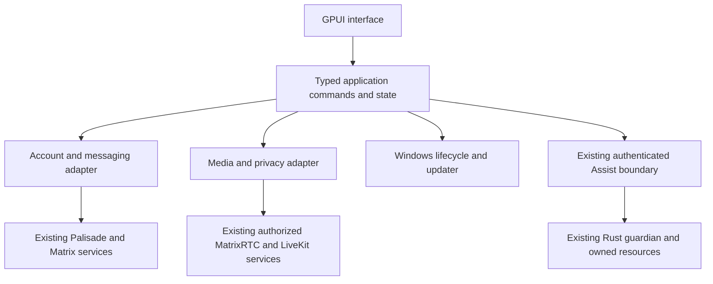

# Rust and GPUI client roadmap

Date: November 22, 2026. Status: roadmap established; implementation not started.
Windows baseline: `7a97fc71e6e1e3cdcb2a2a2b383c611eca369dc5`.
Companion local revision inspected read-only:
`f2aa2634d8580fd082a1fa793b149374d3e3323f`.
The companion revision is an inspection reference, not a compatibility claim.

## Direction and scope

Build toward an independent Rust desktop client with a GPUI interface. Keep the
current Electron client usable and maintained until the replacement meets the
acceptance inventory. Reuse the existing Rust Assist and updater components where
their contracts apply. Do not rewrite their security machinery to accommodate UI.

This roadmap authorizes no production activation, installation, release signing
or publication. Work stays on main in this repository. The companion remains
read-only. No alternate branches, worktrees, backend changes or new production
credentials are required for planning or an offline prototype.

GPUI owns presentation, not Matrix encryption or the media engine. Candidate
libraries are the Matrix Rust SDK and LiveKit Rust SDK. Their existence does not
establish compatibility with Palisade's authentication, MatrixRTC key management,
device-bound authorization or E2EE. Prove those integrations before selecting
versions and committing a dependency lockfile. Native SDK binary dependencies,
licenses and reproducible Windows builds are part of that decision.

## Baseline and reuse inventory

| Area | Current implementation | Migration work |
| --- | --- | --- |
| Desktop UI | `src/window-chrome.*`, isolated Settings and hosted application | Rebuild navigation and controls in GPUI using existing Palisade design tokens |
| Authentication and messages | Hosted application, Matrix SDK, persistent Electron partition | Implement native client integration and supported device verification/recovery |
| Calls and devices | Hosted VoiceApi/LiveKit; Windows media shortcuts partially implemented | Native call/media adapter, E2EE interoperability and privacy controls |
| Assist | `native/assist`, authenticated bridge and isolated media gateway | Reuse guardian boundary; replace Electron coordination and qualify native media integration |
| Updates | `src/updates`, `native/update`, signed release manifests and notes | Move orchestration into Rust while preserving installer verification and trust history |
| Windows shell | Electron lifecycle, tray, notifications, shortcuts and installer registration | Port integration and retain cleanup barriers, single-instance behavior and identity |
| Preferences | Existing atomic desktop/media stores | Explicit non-destructive schema adapters and migration tests |

The media and Assist completion ledgers remain authoritative. This roadmap does
not mark their unfinished features complete or supersede their qualification gates.
See [media checkpoint](MEDIA-RESUME.md), [Assist matrix](ASSIST-COMPLETION-MATRIX.md)
and [update trust](UPDATE-SIGNING.md).

## Delivery milestones

Each milestone ends with a coherent commit, executed evidence and a ledger update.
Do not advance by replacing failed acceptance with mocks. Estimates follow the
first compatibility milestone; there is no supported completion date yet.

| Milestone | Concrete work | Exit evidence |
| --- | --- | --- |
| G0: Baseline and contracts | Inventory actual hosted features, authentication routes, service APIs, design tokens and persisted state. Map every supported desktop feature to a native implementation and test. Identify missing service contracts without changing the companion. | Versioned compatibility inventory, source revisions, dependency/license assessment, fixture-service setup and unresolved questions |
| G1: Offline GPUI foundation | Add an independently buildable prototype under `native/desktop` with a locked toolchain/dependencies. Implement window, navigation, Settings, asynchronous state handling and cancellation. Use synthetic data and a separate development profile. Do not change current packaging. | Clean Windows build; rendered screenshots at normal/high DPI and narrow sizes; keyboard, IME, focus, accessibility and lifecycle assessment |
| G2: Encrypted vertical slice | Against disposable fixture services, sign in using the supported authentication flow, verify a new device, display/decrypt a conversation, send encrypted messages, restart and restore that test session. Join an encrypted voice call with a web participant using authorized synthetic audio. | Real service/web interoperability, verification/recovery tests, reconnect tests and proof that the SFU cannot decode without keys; explicit native SDK compatibility decision |
| G3: Messaging parity | Workspaces/channels, timelines, replies/threads, edits/deletes, reactions, mentions/unread, attachments, search, invites and account/workspace administration supported by current client. Record every remaining feature gap. | Per-feature native/web tests, large-timeline behavior, offline/error recovery, keyboard/screen-reader review and truthful unsupported-state handling |
| G4: Media parity | Calls, device selection/hotplug, mute/deafen/PTT, camera/privacy, volume, processing, screen/window sharing, video surfaces and annotations. Preserve the final outbound privacy gate and encrypted publication. | Synthetic-device regression followed by separately authorized real-device calls, TURN, network recovery, media quality and privacy teardown evidence |
| G5: Assist integration | Attach native UI/coordinator to existing enrollment, SessionGate, leases, source binding, authenticated transport, consent, resources and retained cleanup. Finish missing resource workflows through the existing contracts. | Frozen fixtures and all acceptance cases retained; real cross-client tests and independent security review; unavailable capabilities stay false |
| G6: Windows and migration | Tray/notifications/taskbar, login, shortcuts, diagnostics, update orchestration, installer identity and preferences/account transition. Test old-to-new signed upgrades on disposable VMs. | Installation/upgrade/uninstall and failure-recovery evidence; trusted-key continuity, data preservation, no double-running clients and verified cleanup on quit/update |
| G7: Release candidate | Close parity gaps, audit locked dependencies and native artifacts, measure performance and complete exact-SHA Windows CI and independent review. | Published evidence ledger, approved device acceptance and separately approved release candidate; rollout and recovery instructions |

G1 can proceed without service access. G2 is the first major go/no-go decision:
an attractive UI is insufficient if the existing authentication, encryption or
call path cannot interoperate. G3 and G4 follow the inventory and G2 decisions;
G5 depends on source/media and authority integration. G6 planning starts at G0,
but installation migration is not qualified until the integrated candidate exists.

## Boundaries of the native client

Run network, disk and media work off the UI thread. Bind results to current
account/document-equivalent generation and operation lifetime. Cancel stale work
on account switch, session replacement or shutdown. UI status reflects confirmed
service/native state rather than optimistic permission toggles.

Keep private keys, session tokens and encryption stores outside UI/logging paths.
Preserve narrow native commands, per-session consent and independent emergency
Stop. A fully native interface still processes hostile messages and attachments;
review decoders, rich text, links and resource limits explicitly.

Do not copy the guardian into the UI process just because both are Rust. Keep its
independent safety/cleanup ownership. GPUI is not a substitute for protected consent
or proof of physical input provenance. Windows shared-input arbitration remains
unresolved; `localYield` stays unavailable until its existing safety gate is met.

## Identity, storage and update transition

- Prototype with separate development identity/storage and no production service
  access. Do not read or mutate the current user's Electron profile.
- Do not assume Chromium cookies or Matrix cryptographic stores are portable.
  Prefer supported sign-in plus device verification/recovery. Review whether any
  existing device identity can be preserved through a supported export before
  promising migration. Never silently create an unverified replacement device.
- Preserve the original data directory. Import only allowlisted preferences using
  explicit schema adapters and atomic writes; corrupt data stays recoverable.
- Keep existing release signing roots, authenticated rotations, downgrade floors,
  manifest/notes verification and installer hashes. Do not switch updater formats
  merely because a new UI or SDK offers another one.
- Production cutover must preserve `org.onyxops.palisade`, supported installation
  paths, notification/shortcut identity and ownership rules. A separate prototype
  identity must not accidentally become the production updater target.
- Specify recovery before cutover. Never roll back an incompatible encryption
  database in place or bypass downgrade protections to recover an installation.

## Evidence and release decisions

Track each feature as Planned, Implemented, Unit verified, Fixture interoperable,
Real Windows verified, Independently reviewed or Release approved. Keep those
classifications separate. A CI build or fake media/input sink cannot establish
real microphone, camera, clipboard or physical-input acceptance.

Measure startup, idle/active memory, CPU/GPU, scrolling, call latency and media
quality against the Electron baseline on the same hardware and fixture workload.
Record versions, conditions and failures. No size or speed claim precedes data.

Production issuer trust, working TURN, native security review and approved
disposable-device acceptance remain separate Assist gates. GPUI does not remove
them. Do not activate native input or capture on the owner's personal desktop.

## Next executable slice

1. Produce the G0 feature/contract inventory from the current companion source,
   including its supported authentication and actual encrypted call/key flow.
2. Pin a Windows-compatible GPUI revision; assess Matrix/LiveKit SDK dependencies
   and licenses against the repository toolchain before adding dependencies.
3. Build the G1 offline window and Settings skeleton using synthetic state. Add
   UI screenshots and bounded asynchronous cancellation tests.
4. Document exact fixture-service prerequisites for G2. If native call or auth
   integration needs missing companion APIs, return a precise Claude handoff;
   keep working independently on the offline client.

No credentials, device access or owner decisions are needed to start steps 1-3.
Missing external prerequisites should block only their dependent tests.

## Research references

- [GPUI](https://gpui.rs/) and [source](https://github.com/zed-industries/zed/tree/main/crates/gpui)
- [Matrix Rust SDK](https://github.com/matrix-org/matrix-rust-sdk)
- [Matrix encryption API](https://matrix-org.github.io/matrix-rust-sdk/matrix_sdk/encryption/index.html)
- [LiveKit Rust SDK](https://github.com/livekit/rust-sdks)
- Companion `docs/55-DESIGN-SYSTEM.md` and current account/media source, read-only

These are research inputs, not approved dependency pins or interoperability proof.
