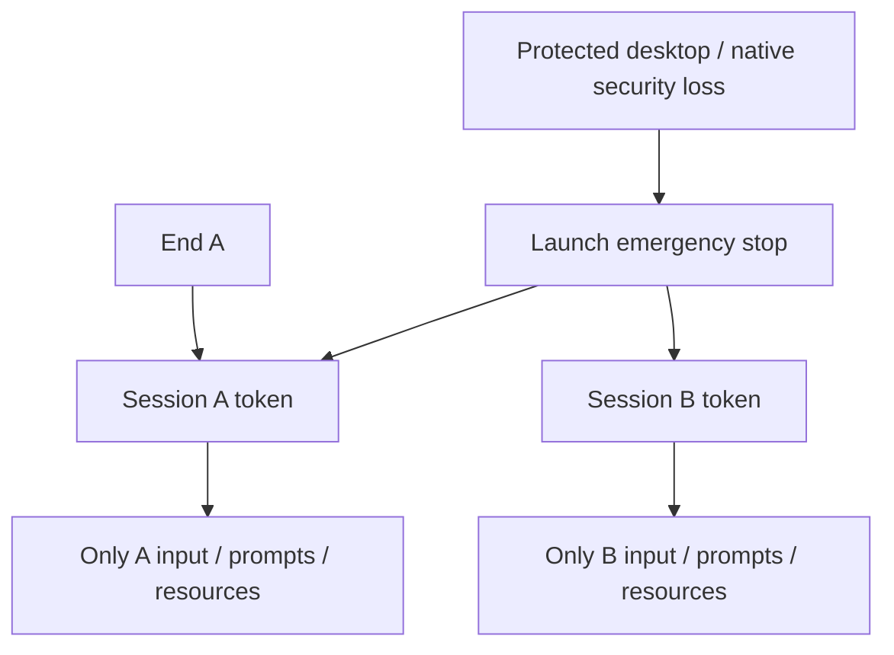

# Native session cancellation isolation

Starting Windows revision: `11f650890192f7ec79035c98424adbbe2e01e3ad`.
Its [exact-SHA Windows CI](https://github.com/cortezdemartino/palisade-windows/actions/runs/42677575263)
passed, including native process checks, installer and packaged checks. The earlier
`e4e5332` CI failure is retained in the [observer correction report](2026-11-09-process-observer-startup.md).

## Defect and correction

`NativeStop::session_flag` previously returned the global emergency-stop atomic.
Ending one dormant `StreamRuntime` would also stop other sessions sharing that
native surface. The connected runtime must not inherit this behavior.

`SessionStop` now contains an immutable launch-stop reference and a separate
terminal session flag. Clones retain the exact child identity. Cancellation reads
both atomics directly and latches observed launch Stop. No propagation worker,
registry lock, renderer timer or reset method is involved.

The existing runtime, executor, pending capability prompts, enrollment weak session
registrations and file authority use this token. Ending one session changes only
its child; ending an enrollment revokes exactly its registered children. Emergency
Stop, parent/lifecycle cancellation and detected protected desktop remain terminal
across the launch. OS failure paths explicitly revoke the launch; lease and ordinary
session failures remain local. Independent review caught and corrected this
distinction before commit.

Peer-observation and resource authorization check cancellation before locking,
after acquiring a busy gate and after the operation. A late successful result
after Stop is refused and that gate is stopped. File confirmation and common
select/save dialog cancellation receive the same token directly, so cancellation
does not depend on a watcher waiting on a gate. Existing per-operation cancellation
and file cleanup ownership remain intact.

## Verification and limits

Formatting and strict Clippy passed. Default and all-feature configurations each
passed **137 Rust tests**: 87 library, 15 executor, 4 input-model, 5 Profile 2,
19 release/ownership and 7 stream authority. Eight added tests cover sibling and
launch scope, weak enrollment ownership, native UI cancellation, resource refusal
before an already-held gate, late authorization success, direct file-dialog
cancellation and runtime revoker isolation. Existing per-primitive executor tests
also execute with the new token. **202 application tests** passed.

Independent source review cleared the corrected dormant boundary; it did not run
builds, process probes or physical tests. The rebuilt default and all-feature
helpers each passed all 25 no-input process groups; hidden-startup visibility also
passed. Local x64 NSIS packaging and packaged native integrity/cleanup probe passed.
The successor exact-SHA CI runs the full packaged desktop/capture/peer checks.

Local unsigned development installer SHA-256:
`0f6c3f59abb9632b9b90806eaf2ea54db2612fa09a947fc487b847f6fbda4860`.
Packaged helper SHA-256:
`df5c841421fed5df55fae7fe1fdda0572fd8537cf7c741a7482b9c531660a0f3`.
These unpublished bytes were not installed and do not replace published v0.3.3.

Classification: **Implemented / Verified in simulation** for authority isolation.
Native message tests post only to owned fixture windows. These tests do not prove
real lock/UAC behavior, remote-input cleanup, full sensitive-UI gesture protection,
group stream interoperability or physical-device acceptance.

The native authority owner, persistent session/tombstone registry, authenticated
positive descendant cleanup receipts and complete live channel remain unfinished.
No feature switch, public protocol, installed application, signing key, published
asset or production service changed.
