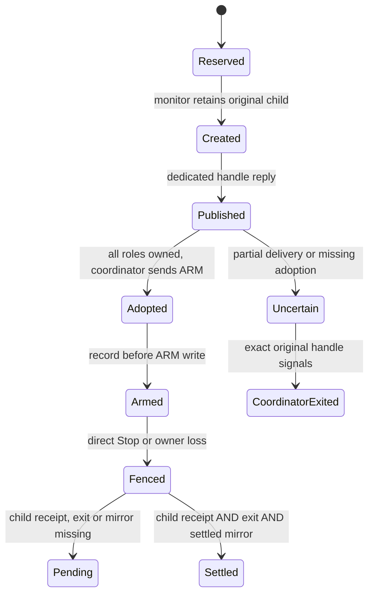

# RC-3 normal executor custody

Starting Windows revision: `b0720e3e69e238dd637106d60e19c0eca8e68203`.
Companion inspected read-only: `f2aa2634d8580fd082a1fa793b149374d3e3323f`.
This is an implementation checkpoint, not full RC-3 acceptance or a release.

## Connected ownership

The application-owned private-v3 endpoint now supplies a dedicated monitor custody
connection and independent cancellation event. The existing StreamRuntime factory
requires this sealed runtime owner. Its existing SessionGate reservation supplies
the session, slot, execution generation and source. There is no second grant
registry or input executor.

The monitor reserves a fresh ticket before creation, retains the verified helper
image, atomically assigns the child to its non-killing job, and retains the original
child handle. Only bounded pipe/query roles reach the exact retained coordinator.
The monitor owns the dedicated child terminal reader and ARM writer. Native
children verify monitor, coordinator, global/per-generation Stop, source, nonce
and ARM before hooks, READY or input. Steps cannot replace the sealed source.
The old coordinator-created normal path is refused. Standalone executor probes
remain non-authorizing. Application identity, updater trust and storage are unchanged.



An uncertain or published-but-unacknowledged handoff blocks successors and input-slot
retirement even after an unarmed child exits. A started write is potentially
delivered, including a flush failure. Do not close its remote numeric handles:
the recipient may already have closed/reused them. Retain the handoff and exact
coordinator until actual exit. Pre-publication partial transfers roll back their
unpublished copies. A zero-capacity local reply rendezvous prevents raw handles
being queued unread and discarded after timeout. Failed role adoption owns and
closes all valid distinct roles, including those following a malformed role.

## Positive terminal evidence

One child cleanup owner operates independently of ordinary stdout. It fences,
retries release-only cleanup, verifies its owned ledger empty, writes one strict
bounded terminal on stderr and exits. The terminal binds creator, child, injection
tag, generation nonce and Probe/Native mode. The monitor requires one complete
terminal followed by EOF; missing, extra, malformed and wrong-generation evidence
remains failure. Diagnostics are not receipts.

An armed Native generation requires all three:

1. Matching positive child terminal.
2. Actual exit of the original child.
3. Settled coordinator mirror without a sticky synchronization failure.

Exit, job zero, EOF, object destruction and Probe evidence cannot substitute.
Fenced coordinator mirror release retires logical intent after native evidence;
it sends no duplicate OS UP events. Startup that may have received ARM retains
these obligations. A separate never-armed observation requires recorded no-ARM
state and actual child exit. ARM is recorded before writing and never reset.
It cannot clear an armed generation.

Only positive completion retires the retained InputOwner. Replay tombstones and
original process evidence remain. Missing Native mirror evidence after coordinator
death stays pending; the Probe-only death fallback is not Native proof. Unresolved
ownership can indefinitely block shutdown/update handoff. Never kill a cleanup
holder or treat timeout as settlement. Session logoff/restart recovery still needs
disposable-device qualification.

## Stop and isolation

The coordinator signals a separate cancellation event before custody RPC or mutex
access. The root watcher observes it independently and signals global Stop. Each
child also checks its exact generation event before future primitives. Stop cannot
undo an already executing system call. Ordinary saturation creates no authority.

Monitor shutdown signals Stop before locking and attempts every child closure even
after an earlier error. It records coordinator exit only after the original handle
signals. Child session cancellation retains parent/native witnesses without ending
unrelated sibling sessions.

## Verification

Local checkpoint results:

- 226 application tests and application syntax checks passed.
- Rust formatting, strict all-target/all-feature Clippy, and 217 Rust tests in
  each default/all-feature configuration passed (163 library, 54 integration).
- 38 real no-authority process groups passed per configuration, plus the
  hidden-startup owned-controls fixture. No OS input was injected.
- Windows x64 NSIS packaging and packaged updater/Assist integrity checks passed.
- The packaged helper passed five new terminal/custody/process cases using its
  actual installed-layout bytes and ASAR-protected manifest.
- Packaged Electron passed 30 window/permission cases, isolated capture component
  regressions and 14 fake-input peer transport cases.
- Both locked Rust audits and the production npm audit passed.
- Six upstream source blobs, nine stored fixture copies and all 30 manifest cases
  matched the frozen companion contract. Windows working-copy line endings were
  checked separately from exact stored bytes.

The unsigned local candidate keeps the base version 0.3.4. It was not installed,
signed or published and does not replace the existing GitHub maintenance release.
Artifact SHA-256 values:

| Artifact | SHA-256 |
| --- | --- |
| Palisade-Setup-0.3.4-x64.exe | `10e8854efd76b7f69668ba94a10baa19ee023762f2a729d71615ea4bfaa7f929` |
| app.asar | `56d6974e28d007a4f0c8e0503156ba5de742016cf36700d080c883afdced4146` |
| Palisade-Assist.exe | `f9a2539d110c953183e432d4fb3bccc98f2d7ac3907fc40b23750783ea6cb8bf` |

Final candidate commands/counts and exact-SHA CI are recorded in issue #1 after
execution. Pending checks are not passes. Commands:

```text
npm run check
npm run test:assist-native
npm run build:assist
npm run test:assist-process
npm run package:win
npm run verify:update-package
npm run verify:assist-package
npm run test:window-controls
npm run test:assist-capture
npm run test:assist-peer
cargo audit --file native/assist/Cargo.lock --deny warnings
cargo audit --file native/update/Cargo.lock --deny warnings
npm audit --omit=dev --audit-level=high
```

Focused tests cover terminal binding, every truncation position, trailing/extra
frames, malformed/oversized receipts, partial transfer, unread late replies, invalid
middle/duplicate roles, Stop before RPC progress, partial/flush-failed publication,
unacknowledged retirement, result substitution and cancellation isolation.

Real compiled Windows Probe processes exercise the production custody transport:
two generations, held fake-input shutdown, deterministic Stop between creation and
ARM, and coordinator death observed through original process handles. These are
real process/pipe/event operations. They do not inject OS input, access Assist
clipboard/files, enroll an identity, approve consent or run a real-service session.

Independent source review corrected duplicate-handle leaks, early owner retirement,
partial/late reply ownership, unread buffered replies and publication ambiguity.
A regression test found accidental parent-session to global-cancellation escalation;
explicit parent-token retention corrected it. Review clearance covers this inactive
slice only, not physical delivery, real consent or the complete integrated product.

One initial process run used the previous helper while compilation was still
running and failed/cancelled; it is not candidate evidence. Fresh compiled-helper
focused cases passed. An ad hoc frozen-byte check initially compared CRLF working
copies to LF blobs; exact stored blobs and working content were then verified
separately without changing any fixtures.

## Remaining RC-3 work

| Area | Classification and requirement |
| --- | --- |
| Enrollment | Existing hello/key/prove Implemented. Real-service approval and endpoint proof Not Verified. Approved disposable device/service and independent public issuer pin remain outstanding under #5. |
| Persistent runtime | Factory now requires monitor custody and inherited cancellation. Live grant.offer to one launch-owned session registry remains Planned; do not rebuild a gate per grant. |
| Capture | Isolated provider/picker/publication components exist. Native source/service track-name corroboration and session wiring remain Planned. |
| Consent | Existing confirmation is not qualified against synthetic Win32 approvals. Protected capture/input/resource consent remains Planned / Not Verified. |
| Peer | Certificate-bound component needs live grant/lease/consent/source/transport wiring. End-to-end Not Verified. |
| Reacquisition | Fresh service request/approval, positive cleanup, new consent and new peer admission remain Planned. WIN-L02 is not passed. |
| Resources | Extension dispatch and clipboard/image/file/sync/drop/resume live integration remain Planned / Experimental components. No capabilities are advertised. |
| Cooperative input | Blocked by the documented physical delivery race. localYield remains false. Positive process evidence does not prove safe host/helper release arbitration. |
| Real acceptance | All 30 frozen cases remain Not Verified on a real endpoint. Probe process success does not pass WIN-P01, WIN-L02 or physical WIN-Y cases. |

At the inspected companion revision, docs/54 still waits for decoded capture before
enrollment inspection. No separately committed enrollment-only harness was found.
Use the canonical operations for that separate stage without relaxing WIN-P01.

Six frozen source blobs, nine fixture families and all 30 cases were independently
compared to companion main. Manifest SHA-256 is unchanged:
`f9ac9d835333e341907ae63f2d2a497ef4944607ea60fc344e81ad64115606b0`.
Control/cooperative/extension source blobs remain
`29bfd8d51d8cf423932379add25b83ae06334d8c`,
`caaadb956475a91c2b7e1776651d7c7a8a88f873`, and
`005ac6ce6ca4b7c4fc27bcc32aa6d9d5f7ad03e1`.

No signing, release, installer execution, personal-device input acceptance,
production issuer setup or feature activation is performed. Production issuer #47,
TURN #48, Firefox #49, integrated review #33 and device acceptance #5 remain separate.
Full RC-3 is unfinished and is not waiting only on web.

## CI fixture correction

The first pushed checkpoint `6c728ea27c5ebcee97e76855ee8cc9ea4b49703c`
failed [Windows CI43492625137](https://github.com/cortezdemartino/palisade-windows/actions/runs/43492625137).
Four existing PowerShell-based pipe fixtures never produced their preparation
markers within 15 seconds. The discarded shell diagnostics do not establish the
specific host cause; this is not a passed candidate run.

The fixtures now use a fixed no-authority actor in the native test executable.
It validates the creator, registers with a bounded private preparation marker,
emits the same valid/invalid ACKs, and records actual EOF cleanup. The unit-runner
preamble is consumed only by fixture setup; the production ACK parser is unchanged.
Missing stdout is simulated after creator validation. No shell startup, command
interpreter or forced input-holder termination is needed. The native three-second
startup deadline and all malformed/cleanup assertions remain unchanged. The extra
test actor makes the native suite total 218 per configuration after this correction.
