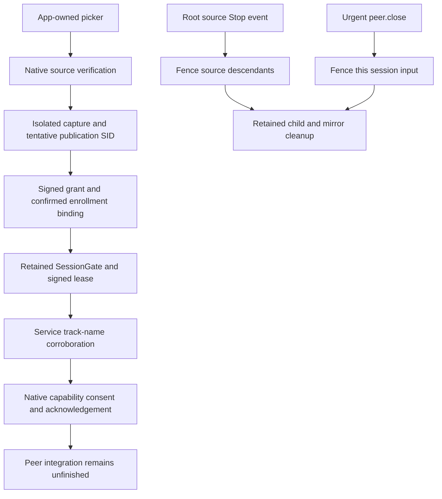

# RC-3 native source and session continuation

Date: November 13, 2026. Windows starting checkpoint:
`4ce232e20c8bf07f7f222ffc2f69a1cea7409a95`.
The RC-3 assignment started at `b0720e3e69e238dd637106d60e19c0eca8e68203`.
Companion inspected read-only: `33e07ee158194adc1be547d838f79cdb8c38d6b0`.

## Implemented scope

- Private v3 connects capture setup, selected-source metadata and read-only
  local socket inspection. These commands are unavailable through the hosted
  API and private versions 1/2. Existing canonical page messages are unchanged.
- Only the explicit qualification build can configure capture. A probe, public
  build, repeated setup or late renderer document cannot activate it. Main
  instantiates the existing isolated provider and picker after native setup.
- Main matches the selected Electron display ID and converts its bounds to
  physical coordinates. Native code independently requires the exact current
  monitor geometry. Window selection retains the original same-user/session
  process and checks the HWND/PID. Window capture supplies no input geometry.
- Native verification finishes before media starts. Cancel, hide, source loss,
  renderer loss and native hierarchy loss tear down the owned media path.
  This does not bypass the hosted session's generic display-capture denial.
- Root-owned events bind cancellation to the exact document/operation. Native
  sessions inherit that source witness as a local scope, rather than revoking
  the launch or unrelated sessions. Normal native children inherit its event
  read-only and inspect it before further input primitives.
- Canonical grant.offer uses one retained StreamRuntime/SessionGate/LeasePoller
  per session. The locally confirmed enrollment, app-owned source, signed grant,
  source room/SID, helper binding and immutable gate deadline are checked.
  The service must corroborate `palisade-capture:<operation>` before native
  consent. A mismatching track name terminates that runtime. Ended sessions are
  retained as tombstones, with a maximum of 16 per endpoint launch.
- Consent acknowledgement uses the same launch-owned operational signer.
  Default packaged helpers still compile out input/resources, so these positive
  operations are not usable or advertised in the maintenance application.
- Urgent peer.close records terminal input revocation even before runtime
  registration. It signals the existing direct executor Stop event, without
  waiting for the ordinary worker, and preserves independent resources. The
  Electron abort path likewise targets that session instead of the whole launch.
- Endpoint shutdown revokes all retained runtimes and joins their cleanup before
  acknowledging completion. The root still requires the existing exact child,
  terminal receipt, mirror and process witnesses. Source/peer Stop replies are
  fencing acknowledgements, not cleanup receipts.

## Sensitive interfaces and availability

The existing named InputOwner object now excludes Palisade input executors and
cleanup holders from native consent, file dialogs and the source picker. A
retained child owner prevents an unsettled cleanup from racing an approval.
This is exclusion against Palisade-owned input; it does not establish physical
user authentication against arbitrary same-user native automation.

Enrollment I/O is refused as Busy while a picker is pending. Source cancellation
is harvested before that decision, and the idle coordinator retires canceled
picker guards without requiring a new page request. This preserves the existing
companion capture-before-enrollment flow without holding unused input exclusion
through a blocking issuer request.

Socket inspection runs in a separate bounded root worker, retaining the exact
application handle. Consent, HTTPS and custody work cannot starve it. The root
reader still processes Stop independently; the inspector rechecks terminal
Stop before returning a positive result. Forwarded inspection frames consume
the coordinator's ordered sequence without ordinary work or a duplicate reply.
V3 has ordinary capacity eight and total capacity 13, including independent
inspection/safety capacity and one slot reserved for Shutdown.

## Independent source review

The separate reviewer inspected the integration without executing input or UI.
Corrections from that review include:

1. Dispose the Electron media path immediately on native loss, including while
   native cleanup remains pending.
2. Tombstone unknown source cancellations at root and main; refuse delayed starts
   reusing those IDs. Bound the tombstones to 128 and fail closed on exhaustion.
3. Move socket inspection outside the blocking endpoint/consent dispatcher.
4. Reap canceled picker exclusion and prevent enrollment I/O during a pending
   picker.
5. Preserve session-scoped input cancellation across the actual bridge/runtime
   adapter, including when peer.close cancels a pending grant.

Complete integrated security qualification remains a separate release gate.
The reviewer cleared the corrected inactive/qualification slice and separately
ran the bridge/runtime Node tests: 18 passed, no skips. Native code was reviewed
without input, UI, binary, service or installation execution.

## Frozen compatibility

Six source blobs, nine fixture families and all 30 manifest cases were
independently compared with the companion's current main. No fixture changed.

| Item | Pin |
| --- | --- |
| Control protocol git blob | `29bfd8d51d8cf423932379add25b83ae06334d8c` |
| Cooperative source git blob | `caaadb956475a91c2b7e1776651d7c7a8a88f873` |
| Extension source git blob | `005ac6ce6ca4b7c4fc27bcc32aa6d9d5f7ad03e1` |
| Yield fixture SHA-256 | `5e678a011977aa063bba30200234ae9bb0fd971196daf198143e208155b74e89` |
| Frozen manifest SHA-256 | `f9ac9d835333e341907ae63f2d2a497ef4944607ea60fc344e81ad64115606b0` |

## Verification record

Executed locally on Windows x64, Node 22.23.4, Electron 44.7.2, Rust 1.98.1:

| Command/check | Result and classification |
| --- | --- |
| `npm run check` | 240 app tests passed; syntax passed |
| `npm run test:assist-native` | Format and strict all-target/all-feature Clippy passed; 227 tests/configuration (173 library + 54 integration), default and all features |
| `npm run test:assist-process` | 39 actual no-authority Windows process groups/configuration, default release and all-feature debug; owned-control visibility test passed |
| Packaged helper focused process run | Six cases passed against the actual packaged bytes, including safety under ordinary saturation |
| `npm run package:win` | Unsigned NSIS x64 installer built; not executed or installed |
| `npm run verify:update-package`, `npm run verify:assist-package` | Packaged source/trust/helper integrity and inactive production policy passed |
| `npm run test:window-controls` | Packaged Electron fixtures passed; 30 permission-boundary cases passed; original development fixture state restored |
| `npm run test:assist-capture` | Synthetic canvas, 12 negative/lifecycle cases and app-owned-window local DTLS fixtures passed; no real-service publication |
| `npm run test:assist-peer` | 14 actual DTLS/fake-native-sink cases passed; no OS input |
| Locked Assist/update `cargo audit --deny warnings`, production `npm audit` | Passed |
| Frozen source/fixture comparison | Six source blobs, nine families, all 30 cases unchanged |
| Independent review | Corrected slice cleared; separate bridge/runtime Node run 18/18 passed |

These categories do not establish native service/device acceptance. Exact
pushed-SHA Windows CI is recorded in the existing Windows #1/#4 issue updates;
a local packaging success is not a GitHub release or CI result.

Unsigned local candidate artifacts:

| Artifact | Bytes | SHA-256 |
| --- | ---: | --- |
| `Palisade-Setup-0.3.4-x64.exe` | 233534399 | `9072f984a041d35f09dee0aee5c1246b817e48c83460633158a3c1d1b320eccd` |
| `app.asar` | 419085 | `09171ed9aeb4236db24cd93578b30f57ed41a0badd94d1b5d8a626077f18d13b` |
| `Palisade-Assist.exe` | 2670592 | `fd44465738ba6c4e9ae5b424668b36138db98d060dc620578771ac11f1635ee9` |

One development process run failed because loading the new capture integration
eagerly imported Electron UI modules in a Node-only enrollment test. Capture is
now imported only when explicitly configured. The focused subprocess regression
then passed; the final broader runs are recorded above.

Another fixture run completed all 30 permission-boundary assertions but failed
restoring the development Electron executable's original fuse state afterward:
Windows returned `UNKNOWN`, errno -4094, on opening that exact file. The original
fixture state was restored successfully. Restoration now retries only this
exact Windows open failure within the existing bounded retry window. Other
paths, operations and permanent errors still fail; application/package fuses and
security assertions are unchanged. Separate tests cover the retry boundary.

### Exact-SHA CI correction

The [first pushed candidate's CI](https://github.com/cortezdemartino/palisade-windows/actions/runs/43504865643)
failed at the custody test `late_unadopted_reply_closes_full_bundle_without_arm`.
That test checked whether numeric handle slots were invalid after closure.
Concurrent Windows tests can reuse those slots; that assertion does not identify
which kernel object remains open. The CI log alone did not prove a production
leak or identify the object occupying the slot.

The correction changes tests only. Three custody cleanup tests now verify the
original randomly named event disappears, that the transferred writer's read end
reaches broken-pipe EOF, and that the transferred reader's write end refuses a
bounded byte. They deliberately allocate replacement objects after closure.
Another negative test proves those pipe witnesses do not report completion while
a reader or writer alias remains alive. No native cleanup rule was relaxed, no
test was skipped and no production code changed. See Microsoft's
[event objects](https://learn.microsoft.com/en-us/windows/win32/sync/event-objects)
and [pipe inspection API](https://learn.microsoft.com/en-us/windows/win32/api/namedpipeapi/nf-namedpipeapi-peeknamedpipe).

After the correction, the complete local native checks passed again: formatting,
strict all-target/all-feature Clippy and **228 tests per configuration** (174
library + 54 integration), default and all features. Other source/package results
above are unchanged. The correction's exact pushed-SHA CI outcome is recorded in
Windows #1/#4 after execution.

## Remaining engineering and acceptance

RC-3 is not complete. These are Windows implementation gaps, not web blockers:

- Authenticated peer preparation, transport statement signing, observed
  certificate admission and packet dispatch through the actual live endpoint.
- Profile 2 negotiation. The connected initial runtime still uses Legacy;
  no Profile 2 feature may be advertised from component tests.
- Fresh input acquisition after terminal Stop. The existing gate remains
  terminal, with no automatic reuse of previous grants, consent or peer state.
- Canonical native extension resource dispatch, transfers, sync, drop and resume.
- Full permission/status lifecycle integration and integrated security review.

Actual service enrollment, native Allow/Deny, encrypted Windows-to-web viewing,
physical input, received files and clipboard operations were not executed.
All 30 real native acceptance cases remain Not Verified. WIN-Y01 through WIN-Y04
also retain the independent physical-delivery arbitration blocker; localYield
stays false. The 30-case manifest is unchanged.

Owner-only prerequisites remain in Windows #5: an approved disposable Windows
device/account, isolated test service/TLS and independently supplied public issuer
pin. No production key was generated or installed. Companion docs/54 still
requires decoded capture before its enrollment inspection; no independently
executable enrollment-only harness was found at the inspected revision.

Continue peer/Profile 2 integration, fresh authority and resources using this
retained runtime. Then execute the existing docs/54 qualification harness on the
approved device. Record the exact Windows/web/service SHAs, public pin, endpoint
key, approved device and observed native results. Production issuer #47, TURN
#48, Firefox #49, independent security review #33 and owner release approval
remain separate gates. No release, installation or production activation occurred.
