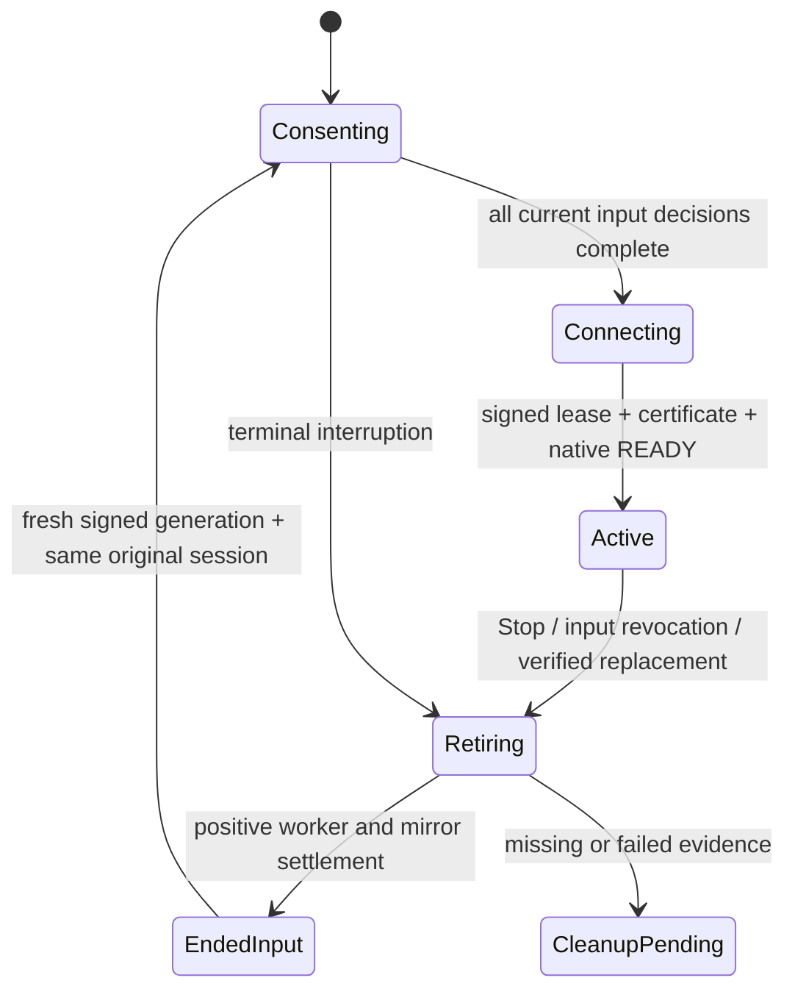

# Fresh native control acquisition

Starting revision: `50400ddd6316b37275f5e11437341a554ee3f0a3`.
The [starting exact-SHA CI](https://github.com/cortezdemartino/palisade-windows/actions/runs/43678677145)
passed. This continuation implements recovery in the existing runtime; it is not
real-device WIN-L02 acceptance or permission to activate Assist.

## Runtime and cleanup

One session retains its enrollment, source, SessionGate, LeasePoller and original
approval/deadline. An issuer-verified new input generation fences the old input
worker, signals its exact executor event, waits for its retained positive join
and gate/mirror settlement, and only then installs another worker generation.
A source with no input child still has an explicit joined outcome. Missing or
failed cleanup remains sticky. No guardian exit, timeout or empty queue counts
as an input-release receipt. The old peer, native consent and permits cannot be
reused. Independent clipboard/file grants and the logical resource authority remain
separate from input revocation. This does not prove a resource connection survives:
the current input gateway closes its whole peer and resource transport/liveness
still require integration before any resource flag can be declared.

The native service view is published only after its entire signed grant set and
covering lease validate. Per-capability Allow/Deny dialogs remain separate.
Before allocating a peer attempt, native requires each current same-generation
input record to be consented or denied. Partial approval works in both directions.
Adding the second member of a fresh cohort does not advance the input epoch or
invalidate its first member's setup witness. An exact already-consented retry
revalidates the signed record, source, current service view and lease before
returning its acknowledgement without another dialog or connection reset.
A signed higher generation can retire a revoked pre-READY worker without waiting
for another lease poll. A denied, never-consented member alone does not terminate
the allowed member. No previous permission is automatically restored.

## Cancellation and stale work

Private v3 adds `cancel-native {target}`. Signed operation cancellation is bound
before cleanup/admission can block, with canonical bytes, generation and nonce
retained only as an immutable cancellation witness. It creates no authority and
does not advance admitted high-water while uncanceled. Canceled generations enter
the effective high-water immediately; a worker timer is not needed to close that
race. Repeated staged/revoked and canceled-cohort service records retain inactive
canonical history, preserving independent resource leases without re-admission. The single ordered native reader captures
an immutable request scope before ordinary dispatch; cancellation targets its
original sequence even after ACK delivery. A bound canceled grant cannot acquire
a new cancellation owner. Idle gate ticks revoke canceled consent and fence held
input. Setup, dequeue and every primitive recheck under the gate; queued work
cannot mint a new epoch's permit after its original input generation ended.
Request deadlines cancel only that original operation, not the whole session.
Abandoned prompts retain their join/cleanup and are harvested without exhausting
future consent slots; cleanup failure remains terminal and sticky. Canceled verified offers remain inactive, bounded history; reusing the
same ID/nonce cannot restore them. A genuinely fresh acquisition must advance the
signed generation beyond the observed high-water, including canceled offers.

Explicit input Stop advances a native ingress revision. A request queued before
that boundary cannot adopt the new revision merely because it executes later.
Independent resource requests ignore input-only Stop revisions but retain their
own cancellation flag and full-session/source checks. Private per-attempt close
can signal only its retained original input revoker, not a successor. Explicit
Host Stop continues to target the current generation, including repeated Stop.

Trusted main asks native to classify an input offer before intentionally retiring
a connection. Raw page JSON cannot close/reset an active peer. Same-generation
ACKs retain it. Expected retirement invalidates the old bridge lifetime without
publishing an unscoped terminal event about the new connection. Post-ACK native
generation verification cannot clear a newer Stop fence. Peer setup can wait for
bounded human consent; ordinary input-owner contention does not prematurely
terminate an otherwise pending, unadmitted acquisition.

## Disposable-device recovery procedure (Not Verified)

Use only the independently approved isolated issuer/service and disposable Windows
installation in Windows #5 and companion docs/54. This procedure does not authorize
personal-device input, production services or a new installer installation.

1. Record exact Windows/web SHAs, endpoint fingerprint, session/stream/source,
   signed input IDs/generations and immutable approval/deadline. Establish the
   real locally approved certificate-bound connection using that harness.
2. Exercise the approved test input, then Host Stop. Confirm input is fenced and
   positive native child/mirror cleanup completes; viewing/resources must be
   checked separately rather than inferred from grant state.
3. Have the helper make a new service input request and publisher explicitly
   approve its capabilities. Confirm new IDs/nonces and a higher generation with
   the same original deadline. Complete separate native permission dialogs.
4. Wait for their decisions, fresh service acknowledgements and a covering signed
   lease. Verify the new observed peer and actual native READY before input.
5. Test mouse-only and keyboard-only partial approval, late same-generation ACK,
   repeat Stop during consent/ACK, old queued packets/callbacks, cleanup failure,
   lease/source loss and original expiry. Old authority must never resume.
6. Collect device-side native receipt evidence and the matching web harness
   reports for WIN-L02 and lifecycle cases. A fake sink or successful process test
   cannot satisfy this procedure. The companion stale-loss fix is required before
   claiming successful cross-client recovery.

## Verification and limits

- `npm run check`: 268 passed, zero skipped; extension reproduction/syntax passed.
- `npm run test:assist-native`: formatting and strict all-target/all-feature Clippy
  passed; default and all-feature configurations passed 251 tests each.
- Focused coverage includes both partial approval directions, unchanged cohort
  epoch, canceled/replayed offers, stale grant/nonce/generation/device/deadline,
  original session preservation, positive executor/mirror cleanup, resource
  independence, native ingress Stop revisions, old transport cancellation and
  Stop during fresh ACK verification.
- Rebuilt helper process suites: 41 passed in default Probe configuration and
  41 passed with all features compiled, zero skipped; the hidden-startup lifecycle
  fixture also passed. The live subset contains 28 cases, including urgent private
  cancellation behind saturated ordinary work. These are no-authority processes.
  Windows NSIS packaging and update/Assist package-integrity checks passed.
  Packaged controls/permissions: 30 passed. Isolated capture: 12 negative/lifecycle
  cases plus synthetic/owned-window DTLS checks passed. Owned input DTLS transport:
  14 passed with a fake sink. Unpublished installer SHA-256:
  `b21e29036791f9fe5c77e6ff40b97886253850391df916ac41d532ac8e708795`.
  Exact pushed-SHA CI is recorded in Windows #1/#4. Real processes
  run Probe/no-authority modes; fake input sinks are not physical acceptance.
- Independent source review found and corrected premature peer retirement,
  stale cancellation/revision, cohort consent, deadline resource revocation,
  queued-epoch adoption and missing staged tombstones. Final focused independent
  verification passed 45 Node tests, 9 cancellation/cohort tests and 18 executor
  ordering tests. No blocking source finding remains in this increment. This is
  source/unit review; full integrated Assist security and device review stay open.

Companion main inspected read-only at `24b722c206f86651378aeae447252ea71977823a`.
Its frozen six sources, nine fixture families and 30 cases are unchanged. The
old-peer-loss race can revoke a fresh service grant; its input-only Stop action
also calls global native Stop. Both companion corrections remain separate from
Windows resource transport implementation. See the exact reproducer and Claude instructions in
[the companion handoff](../ASSIST-COMPANION-HANDOFF-PROMPT.md).

Local dependency audits passed: zero production npm advisories and no warnings
in either locked Rust dependency graph. The first parallel packaging attempt hit
Windows EBUSY because process tests owned the helper executable; packaging is
repeated serially after positive test-process cleanup, without killing holders.
An earlier broad regression caught an overly global input-authorization guard;
it was narrowed to live peer setup, retaining the canonical release-authority
test unchanged. Both complete native configurations then passed.

Native clipboard/image/file/drop/resume/sync execution and retained progress
lifetimes still require Windows engineering. All corresponding capability flags
remain false. All 30 real acceptance cases are Not Verified. Physical cooperative
delivery remains Blocked. Issuer #47, TURN #48, Firefox #49, disposable Windows #5,
integrated review #33 and owner release approval remain separate gates. No
production switch, installer installation, release signing or publication changed.
